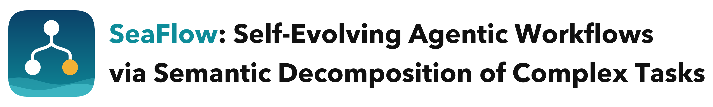
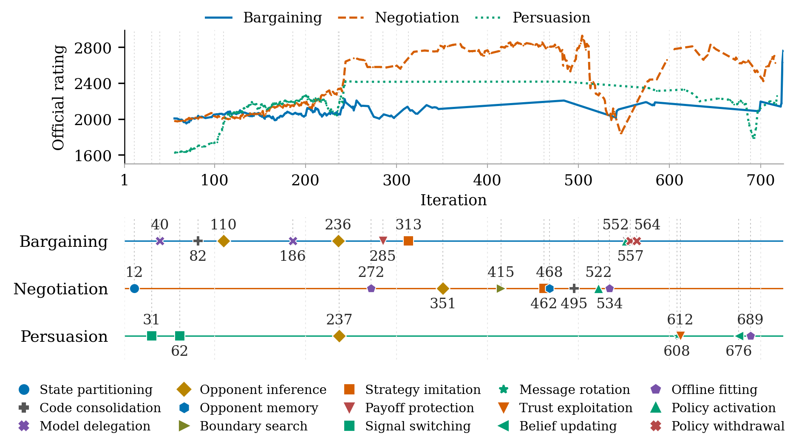
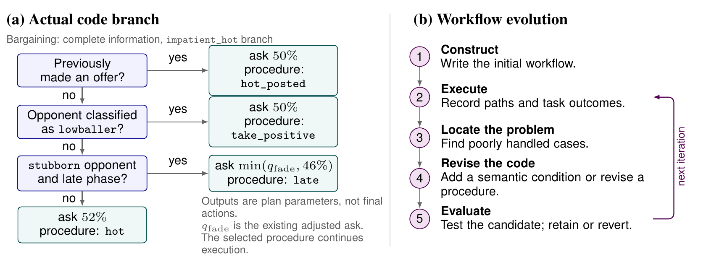

<!-- # SeaFlow -->

<div align="center">

<picture>
  <source media="(prefers-color-scheme: dark)" srcset="assets/title_dark.png">
  
</picture>
<hr>

Zichuan Fu<sup>1</sup>, Junjia Qi<sup>1</sup>, Xian Wu<sup>2</sup>, Wenlin Zhang<sup>1</sup>, Yimin Deng<sup>1</sup>, Kaifeng Guo<sup>1</sup>, Xiangyu Zhao<sup>1</sup>

<sup>1</sup>City University of Hong Kong &nbsp; <sup>2</sup>Tencent Jarvis Lab

<h4>
<a href="https://fzkuji2026.github.io/SeaFlow/">🌐 Project Page</a> &nbsp;
<a href="https://github.com/fzkuji-neo/OpenProgram">🛠️ OpenProgram</a>
</h4>

[](https://glee-competition.com/) [](https://glee-competition.com/) [](https://github.com/fzkuji-neo/OpenProgram) [](https://www.python.org/)

</div>

SeaFlow is the agent that ranked **first overall in the [GLEE competition](https://glee-competition.com/)**, which scores agents on Bargaining, Negotiation and Persuasion. Its workflows split each game into subtasks by the situation the agent observes, and solve each subtask with code. A coding agent revises the workflows from game records, so the decision logic grows through hundreds of iterations while every live decision stays fast and inspectable.

## 🏆 Results

🥇 **1st overall** on the GLEE leaderboard with an overall rating of **2594.5**, using the final workflows at revision `a1875a0`:

<div align="center">

| | Overall | Bargaining | Negotiation | Persuasion |
| --- | ---: | ---: | ---: | ---: |
| Official GLEE rating | **2594.5** | 2760.3 | 2761.7 | 2261.6 |
| Mean local decision time | – | 0.118 ms | 0.198 ms | 0.122 ms |

</div>

<p align="center">
  
</p>
<p align="center"><em>Official ratings and representative strategy changes on the same 725-iteration axis.</em></p>

## 🧭 How it works

<p align="center">
  
</p>

- **Semantic task decomposition.** Each game is divided into subtasks with explicit conditions, such as the role, the information available, the opponent's behavior and the phase of the game.
- **Code-first procedures.** Each subtask has its own procedure. Most procedures are plain code, and an optional LLM judge only picks among legal alternatives that the code has already computed. The model never invents a price, split or expected value.
- **Revision from execution feedback.** After a batch of games, a coding agent locates poorly handled cases in the records, adds a condition or revises a procedure, and keeps the change only if it holds up on evaluation.

The final agent is mostly code: the LLM judge almost never decides after iteration 90, and every action records the branch that produced it. See the [project page](https://fzkuji2026.github.io/SeaFlow/) for the method details, behavior analysis and the structure of the final workflows.

## 🚀 Quick start

```bash
git clone https://github.com/fzkuji2026/SeaFlow.git && cd SeaFlow
python -m venv .venv && source .venv/bin/activate
pip install -r requirements.txt
cp .env.example .env          # set GLEE_API_KEY
PYTHONPATH=vendor:. python run_agent.py
```

<div align="center">

| Variable | Default | Meaning |
| --- | --- | --- |
| `GLEE_API_KEY` | – | Your GLEE agent key |
| `GLEE_GAME_FAMILIES` | all three | Comma-separated subset of `bargaining,negotiation,persuasion` |
| `GLEE_MAX_GAMES` | `20` | Games to play before stopping |
| `GLEE_CONCURRENCY` | `3` | Games played at the same time |
| `GLEE_LLM_JUDGE` | `1` in `.env.example` | Enable the optional LLM judge (needs `XAI_API_KEY` or OpenProgram's xAI credentials) |
| `GLEE_USE_OPENPROGRAM` | off | Run the agentic functions through OpenProgram |

</div>

Run the tests:

```bash
PYTHONPATH=vendor:. pytest -q
```

## 🔍 Inspect a decision

Every action can be traced back to the workflow branch that produced it. Given a saved game replay, the diagnosis tool prints the decision path and the computed quantities (share, ZOPA, profit, expected value) at any round:

```bash
PYTHONPATH=vendor:. python scripts/diagnose.py --file REPLAY.json --round 3 --action offer
```

## 📁 Repository layout

```
glee_agent/
├── workflows/        # per-game workflows: classify the situation, then route to a procedure
│   ├── bargaining/
│   ├── negotiation/  # routes/: complete, incomplete, no_zopa, ultimatum, ...
│   └── persuasion/   # routes/: buyer_honest, buyer_liar, seller_blind, ...
├── judge.py          # optional LLM judge over legal alternatives
├── diagnose.py       # computed quantities behind each decision
└── reference.json    # public GLEE medians per configuration
glee_runtime/         # game queue, move scheduling and networking
scripts/              # replay diagnosis, reference building and model fitting
docs/                 # method notes and workflow diagrams (docs/workflows/*.html)
tests/                # 500+ unit and replay tests
```

## 🧩 Built on OpenProgram

The self-evolution of SeaFlow is built on [**OpenProgram**](https://github.com/fzkuji-neo/OpenProgram), our open-source agentic programming environment. In OpenProgram the program governs all control flow and calls the model only where a task needs reasoning, which is the same principle SeaFlow's workflows follow. You are welcome to build your own self-evolving workflows with it.

## 📖 Citation

```bibtex
@inproceedings{fu2026seaflow,
  title     = {Self-Evolving Agentic Workflows via Semantic Decomposition of Complex Tasks},
  author    = {Fu, Zichuan and Qi, Junjia and Wu, Xian and Zhang, Wenlin and Deng, Yimin and Guo, Kaifeng and Zhao, Xiangyu},
  booktitle = {NeurIPS 2026 Workshop on Interpreting Agent Behavior (IAB), GLEE Competition Track},
  year      = {2026}
}
```

If you use OpenProgram, please also cite:

```bibtex
@article{qi2026llmascode,
  title   = {{LLM-as-Code}: Agentic Programming for Agent Harness},
  author  = {Qi, Junjia and Fu, Zichuan and Gao, Jingtong and Zhang, Wenlin and Yan, Hanyu and Wu, Xian and Zhao, Xiangyu},
  journal = {arXiv preprint arXiv:2606.15874},
  year    = {2026}
}
```

## 🙏 Acknowledgements

We thank the organizers of the [GLEE competition](https://glee-competition.com/) and the NeurIPS 2026 IAB Workshop.
